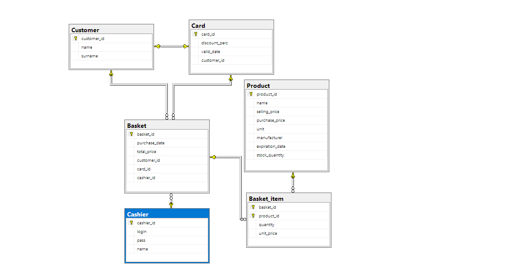
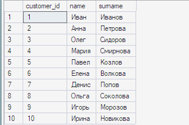
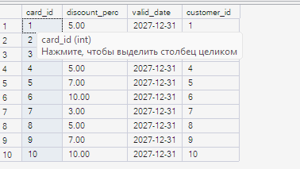
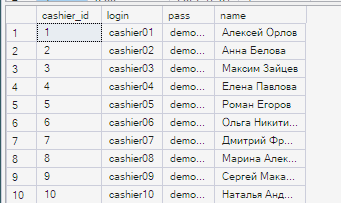
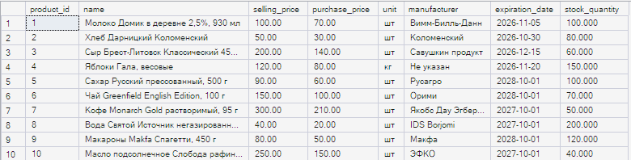
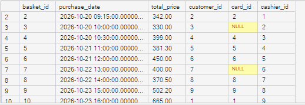
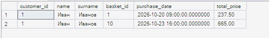

[README.md](https://github.com/user-attachments/files/33993504/README.md)
# Лабораторная работа № 2

## Цель работы

На основе реляционной модели из лабораторной работы № 1 создать базу данных магазина в Microsoft SQL Server: определить таблицы, первичные ключи и ограничения, установить связи между таблицами, построить диаграмму и заполнить каждую таблицу не менее чем 10 записями с примерами связей «один ко многим».

## Диаграмма базы данных



## Покупатели — Customer



## Скидочные карты — Card



## Кассиры — Cashier



## Товары — Product



## Чеки — Basket



## Пример связи «один ко многим»



## Общий SQL-код

[Скачать Lab2.sql](Lab2.sql)

```sql
-- Покупатели
CREATE TABLE Customer (
    customer_id INT IDENTITY(1,1) PRIMARY KEY,
    name NVARCHAR(50) NOT NULL,
    surname NVARCHAR(50) NOT NULL
);

-- Скидочные карты: максимум одна карта у покупателя
CREATE TABLE Card (
    card_id INT IDENTITY(1,1) PRIMARY KEY,
    discount_perc DECIMAL(5,2) NOT NULL,
    valid_date DATE NOT NULL,
    customer_id INT NOT NULL,
    CONSTRAINT UQ_Card_Customer UNIQUE (customer_id),
    CONSTRAINT CK_Card_Discount CHECK (discount_perc BETWEEN 0 AND 100),
    CONSTRAINT FK_Card_Customer FOREIGN KEY (customer_id)
        REFERENCES Customer(customer_id)
);

-- Кассиры
CREATE TABLE Cashier (
    cashier_id INT IDENTITY(1,1) PRIMARY KEY,
    login NVARCHAR(50) NOT NULL UNIQUE,
    pass NVARCHAR(255) NOT NULL,
    name NVARCHAR(100) NOT NULL
);

-- Товары
CREATE TABLE Product (
    product_id INT IDENTITY(1,1) PRIMARY KEY,
    name NVARCHAR(100) NOT NULL,
    selling_price DECIMAL(10,2) NOT NULL,
    purchase_price DECIMAL(10,2) NOT NULL,
    unit NVARCHAR(20) NOT NULL,
    manufacturer NVARCHAR(100) NOT NULL,
    expiration_date DATE NULL,
    stock_quantity DECIMAL(10,3) NOT NULL DEFAULT 0,
    CONSTRAINT CK_Product_SellingPrice CHECK (selling_price >= 0),
    CONSTRAINT CK_Product_PurchasePrice CHECK (purchase_price >= 0),
    CONSTRAINT CK_Product_Stock CHECK (stock_quantity >= 0)
);

-- Чеки: карта может отсутствовать
CREATE TABLE Basket (
    basket_id INT IDENTITY(1,1) PRIMARY KEY,
    purchase_date DATETIME2 NOT NULL DEFAULT SYSDATETIME(),
    total_price DECIMAL(12,2) NOT NULL,
    customer_id INT NOT NULL,
    card_id INT NULL,
    cashier_id INT NOT NULL,
    CONSTRAINT CK_Basket_TotalPrice CHECK (total_price >= 0),
    CONSTRAINT FK_Basket_Customer FOREIGN KEY (customer_id)
        REFERENCES Customer(customer_id),
    CONSTRAINT FK_Basket_Card FOREIGN KEY (card_id)
        REFERENCES Card(card_id),
    CONSTRAINT FK_Basket_Cashier FOREIGN KEY (cashier_id)
        REFERENCES Cashier(cashier_id)
);

-- Состав чека: составной первичный ключ
CREATE TABLE Basket_item (
    basket_id INT NOT NULL,
    product_id INT NOT NULL,
    quantity DECIMAL(10,3) NOT NULL,
    unit_price DECIMAL(10,2) NOT NULL,
    CONSTRAINT PK_Basket_item PRIMARY KEY (basket_id, product_id),
    CONSTRAINT FK_BasketItem_Basket FOREIGN KEY (basket_id)
        REFERENCES Basket(basket_id),
    CONSTRAINT FK_BasketItem_Product FOREIGN KEY (product_id)
        REFERENCES Product(product_id),
    CONSTRAINT CK_BasketItem_Quantity CHECK (quantity > 0),
    CONSTRAINT CK_BasketItem_UnitPrice CHECK (unit_price >= 0)
);
-- Customer
INSERT INTO Customer (name, surname)
VALUES
(N'Иван', N'Иванов'),
(N'Анна', N'Петрова'),
(N'Олег', N'Сидоров'),
(N'Мария', N'Смирнова'),
(N'Павел', N'Козлов'),
(N'Елена', N'Волкова'),
(N'Денис', N'Попов'),
(N'Ольга', N'Соколова'),
(N'Игорь', N'Морозов'),
(N'Ирина', N'Новикова');

-- Cashier
INSERT INTO Cashier (login, pass, name)
VALUES
(N'cashier01', N'demo01', N'Алексей Орлов'),
(N'cashier02', N'demo02', N'Анна Белова'),
(N'cashier03', N'demo03', N'Максим Зайцев'),
(N'cashier04', N'demo04', N'Елена Павлова'),
(N'cashier05', N'demo05', N'Роман Егоров'),
(N'cashier06', N'demo06', N'Ольга Никитина'),
(N'cashier07', N'demo07', N'Дмитрий Фролов'),
(N'cashier08', N'demo08', N'Марина Алексеева'),
(N'cashier09', N'demo09', N'Сергей Макаров'),
(N'cashier10', N'demo10', N'Наталья Андреева');

-- Product
INSERT INTO Product (name, selling_price, purchase_price, unit, manufacturer, expiration_date, stock_quantity)
VALUES
(N'Молоко Домик в деревне 2,5%, 930 мл', 100, 70, N'шт', N'Вимм-Билль-Данн', N'20261105', 100),
(N'Хлеб Дарницкий Коломенский', 50, 30, N'шт', N'Коломенский', N'20261030', 80),
(N'Сыр Брест-Литовск Классический 45%, 200 г', 200, 140, N'шт', N'Савушкин продукт', N'20261215', 60),
(N'Яблоки Гала, весовые', 120, 80, N'кг', N'Не указан', N'20261120', 150),
(N'Сахар Русский прессованный, 500 г', 90, 60, N'шт', N'Русагро', N'20281001', 100),
(N'Чай Greenfield English Edition, 100 г', 150, 100, N'шт', N'Орими', N'20281001', 70),
(N'Кофе Monarch Gold растворимый, 95 г', 300, 210, N'шт', N'Якобс Дау Эгбертс Рус', N'20271001', 50),
(N'Вода Святой Источник негазированная, 1,5 л', 40, 20, N'шт', N'IDS Borjomi', N'20271001', 200),
(N'Макароны Makfa Спагетти, 450 г', 80, 50, N'шт', N'Макфа', N'20281001', 120),
(N'Масло подсолнечное Слобода рафинированное, 1 л', 250, 150, N'шт', N'ЭФКО', N'20271001', 40);

-- Card
INSERT INTO Card (discount_perc, valid_date, customer_id)
VALUES
(5, N'20271231', 1),
(10, N'20271231', 2),
(3, N'20271231', 3),
(5, N'20271231', 4),
(7, N'20271231', 5),
(10, N'20271231', 6),
(3, N'20271231', 7),
(5, N'20271231', 8),
(7, N'20271231', 9),
(10, N'20271231', 10);

-- Basket
INSERT INTO Basket (purchase_date, total_price, customer_id, card_id, cashier_id)
VALUES
(N'2026-10-20T09:00:00', 0, 1, 1, 1),
(N'2026-10-20T09:15:00', 0, 2, 2, 1),
(N'2026-10-20T10:00:00', 0, 3, NULL, 2),
(N'2026-10-20T10:30:00', 0, 4, 4, 3),
(N'2026-10-21T11:00:00', 0, 5, 5, 4),
(N'2026-10-21T12:00:00', 0, 6, 6, 5),
(N'2026-10-22T13:00:00', 0, 7, NULL, 6),
(N'2026-10-22T14:00:00', 0, 8, 8, 7),
(N'2026-10-23T15:00:00', 0, 9, 9, 8),
(N'2026-10-23T16:00:00', 0, 1, 1, 9);

-- Basket_item
INSERT INTO Basket_item (basket_id, product_id, quantity, unit_price)
VALUES
(1, 1, 2, 100),
(1, 2, 1, 50),
(2, 3, 1, 200),
(2, 4, 1.5, 120),
(3, 5, 2, 90),
(3, 6, 1, 150),
(4, 7, 1, 300),
(4, 8, 3, 40),
(5, 9, 2, 80),
(5, 10, 1, 250),
(6, 1, 1, 100),
(6, 3, 2, 200),
(7, 2, 2, 50),
(7, 4, 2.5, 120),
(8, 5, 1, 90),
(8, 7, 1, 300),
(9, 6, 2, 150),
(9, 9, 3, 80),
(10, 8, 5, 40),
(10, 10, 2, 250);

-- Итог чека: сумма позиций минус скидка, округление до копеек.
UPDATE b
SET total_price = ROUND(
    s.subtotal * (1 - COALESCE(c.discount_perc, 0) / 100.0), 2
)
FROM Basket AS b
JOIN (
    SELECT basket_id, SUM(quantity * unit_price) AS subtotal
    FROM Basket_item
    GROUP BY basket_id
) AS s ON s.basket_id = b.basket_id
LEFT JOIN Card AS c ON c.card_id = b.card_id;
```
